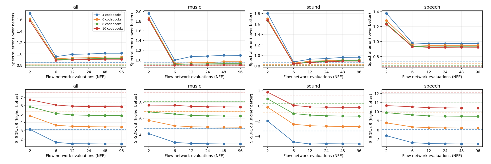
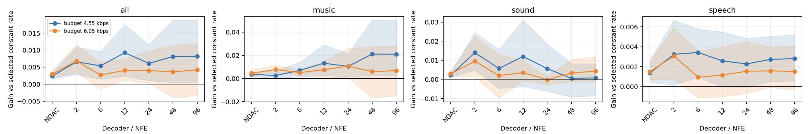
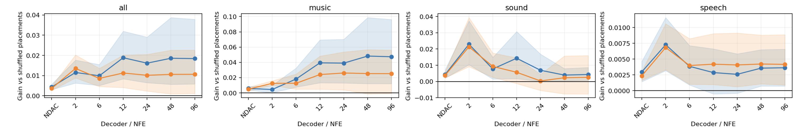

# Variable bitrate flow matching audio codecs: plausibility survey

## Background
Neural audio codecs are a form of autoencoder which leverage the flexibility of deep neural networks to perform lossy compression of audio clips with great fidelity. They work by embedding the clips into a discrete sequence of tokens in a lower dimensional space. Critically, many implementations quantize this lower dimensional space to achieve greater compression, as the cost of storing integer indices into a fixed set of codebook entries is lower than that of storing the floating point vectors comprising the latent space. As such, the compressed representation of the audio is a discrete-time sequence of integer tokens, each of which is an index into a learned codebook of $R^d$ vectors.
In the Residual Vector Quantization scheme used by many state-of-the-art neural codecs, a hierarchy of codebooks is learned rather than a single dictionary. Therefore, the audio is compressed to a sequence of vectors in $\mathbb{[}0,L\mathbb{]}^C$, where $C$ is the number of codebooks, and the number of bits required to store the representation at each time point is $C\text{log}(L)$. This grants the codec the flexibility to operate at different bitrates by throwing away codebooks as desired.

## Proposal
Most neural audio codecs treat the bitrate as a value which remains constant across the entire audio stream. However, one could imagine allocating greater precision to complex segments of an audio stream while removing precision from regions where it would go unnoticed, thus achieving the same overall bitrate but with greater perceptual quality. In theory, this could be done without modifying the pretrained encoder or decoder, as the excess codebook indices could be discarded post-hoc from an encoder that operates at the maximum supported bitrate and the decoder receives as input the sum of the codebook entries for each time step in $\mathbb{R}^d$. We propose learning a method of assigning importance to intervals of audio which determine the number of codebook entries necessary to reliably reconstruct them. This would allow more capacity to be allocated to segments of audio which are harder to reconstruct with good perceptual quality, thus enabling high-bitrate levels of fidelity through low-capacity channels. Our focus on leveraging bitrate as a means of improving quality is founded in our empirical results showing bitrate has a strong effect on audio quality that diminishes slower that that of increasing the number of function evaluations:

We aim to build on top of [FlowDec](https://arxiv.org/abs/2503.01485), a neural audio codec which utilizes conditional flow matching to refine audio generated by a convolutional decoder. We aim to explore ways of computing a metric on the flow field inferred by this flow matching module to reallocate capacity across a partitioning of the input audio.

## Plausibility survey
The FlowDec model, alongside many other state-of-the-art neural codecs, was trained under the assumption that all elements of the compressed sequence are stored with the same level of precision. Therefore, we first tested whether the model would break when confronted with a variable bitrate sequence (it doesn't). Afterward, we performed a minimal experiment to answer the following questions:
1) Is it possible to benefit from adopting a variable bitrate encoding?
2) Is there a benefit to learning a function to optimally allocate capacity to different parts of the sequence?

To answer these questions, we considered 10s audio clips encoded with an average bitrate of 6kbps or 4.5kbps. As a control, we encoded the audio with a constant bitrate and measured the error between this baseline and the original audio via the multi-resolution short-time Fourier transform (MR-STFT) loss. We then considered a coarse optimization procedure for variable bitrate allocations in which we partition the audio into 2-second intervals, encode one at a rate slightly higher than the constant bitrate, e.g. 8kbps, and another at a rate slightly lower, e.g. 4kbps, such that the overall bitrate is equivalent to the constant rate baseline. We optimize via Monte-Carlo estimation by generating 50 shuffled versions of the allocation array and selecting the best performing strategy. We compare the MR-STFT loss of this strategy to that of the constant bitrate baseline and report the difference below for different choices of the number of evaluations of the flow matching function (positive indicates better performance in the optimized sequence):

While these coarse strategies are not by any means an optimal allocation of capacity within the sequence, we see that the better performing shuffles outperform the constant bitrate baseline. This indicates there is hope for developing a method to find better allocations strotegies. Furthermore, we wish to be certain that learning an optimal allocation function is worth the effort. As a proxy for this, we compare the performance of the optmized allocation strategies to the average performance of 50 random shuffle strategies:

Here we see that even this coarse optimization consistently yields strategies which outperform chance.

## Going forward
Based on the results of these experiments, we believe it is plausible to find allocation strategies that may yield better codec quality while maintaining low bitrates. Our goal going forward is to develop methods of computing these allocation strategies from properties of the learned flow field.